<div align="center">

<picture>
  <source media="(prefers-color-scheme: dark)" srcset="docs/img/logo-oscuro.svg">
  
</picture>

### Tu aplicación, en escena: una oficina viva con un equipo que trabaja delante de ti

**Analiza tu proyecto · inventa el equipo que lo haría funcionar · y lo pone a trabajar en una oficina animada que se mueve con los trabajos reales de tu aplicación**


### [▶ Ver la demo en directo](https://maomur.github.io/livestage/demo/)

<sub>Un trabajo de ejemplo que arranca solo: pulsa a cualquier persona para ver qué hace y cambia de estilo con el selector de arriba a la derecha.</sub>

<br>

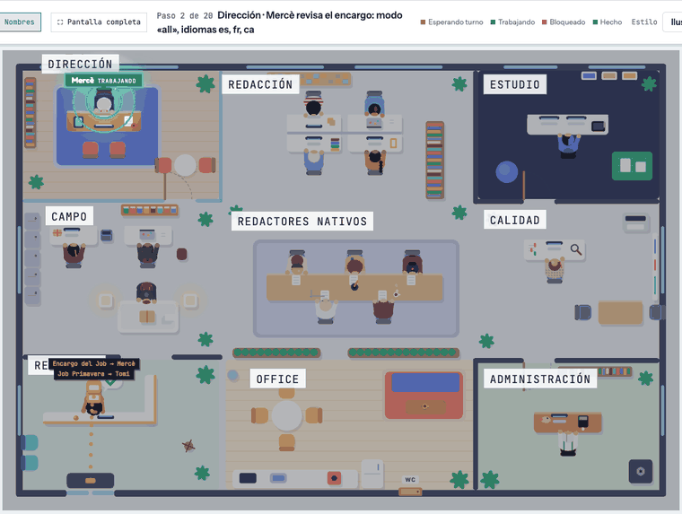

<sub>Cada persona es un proceso de tu aplicación. Quien trabaja se ilumina; los objetos que vuelan son lo que se pasan de una mesa a otra.</sub>

</div>

---

## ✨ ¿Qué es esto?

Un plugin para **[Claude Code](https://claude.com/claude-code)** que mira tu aplicación y la explica como si fuera una empresa:

<table>
<tr>
<td width="33%" align="center">

### 🔍 Entiende
Lee tu código o tu web y reconstruye el flujo de principio a fin: qué lo dispara, por dónde pasa y qué produce.

</td>
<td width="33%" align="center">

### 👥 Inventa el equipo
Define los procesos y crea **una persona por rol**, con nombre, edad, estudios, experiencia y responsabilidades.

</td>
<td width="33%" align="center">

### 🎬 Lo pone a trabajar
Monta una **oficina animada** donde ese equipo trabaja, se pasa el trabajo y el jefe presenta el informe final.

</td>
</tr>
</table>

> 💡 **Para quién es:** para quien quiere entender una aplicación de un vistazo, explicarla a alguien no técnico, presentarla a un cliente… o simplemente ver su software cobrar vida.

---

## 🎨 8 estilos, un mismo equipo

Elige el que más te guste y cámbialo cuando quieras con el selector de arriba a la derecha. Tu equipo, tus áreas y tus datos se mantienen.

<div align="center">
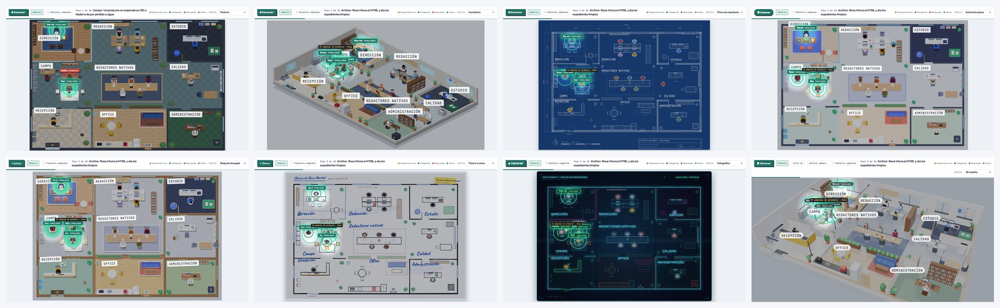
</div>

| | Estilo | Ideal para |
|:-:|---|---|
| 🕹️ | **Pixel art** | Un toque retro y divertido, de videojuego |
| 🧱 | **Isométrico** | Una maqueta en 3D de juguete, muy vistosa |
| 📐 | **Plano de arquitecto** | Presentar a dirección o al equipo técnico |
| 🎨 | **Ilustración plana** | Enseñárselo a un cliente: amable y moderno |
| ✂️ | **Maqueta de papel** | Artesanal, de los que se recuerdan |
| 🖊️ | **Pizarra a mano** | Una reunión informal, como en el tablero |
| 🛸 | **Holográfico** | Impactar: un centro de operaciones futurista |
| 🧊 | **3D realista** | Lo más espectacular: gira, acerca y modo Ultra 4K |

<details>
<summary><b>👀 Ver cada estilo en grande</b></summary>
<br>

| Pixel art | Isométrico |
|:-:|:-:|
| 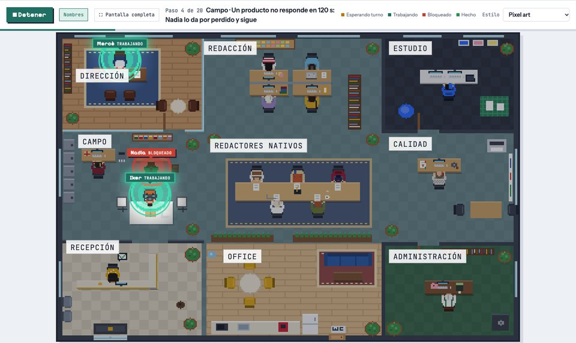 | 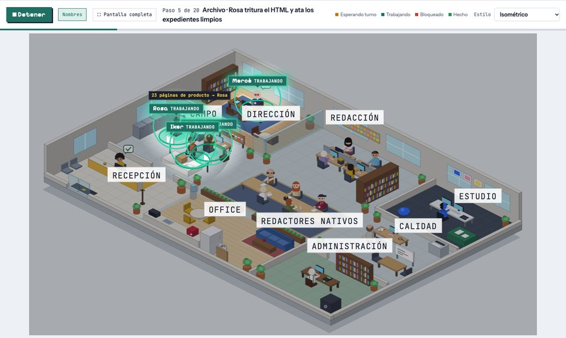 |
| **Plano de arquitecto** | **Ilustración plana** |
| 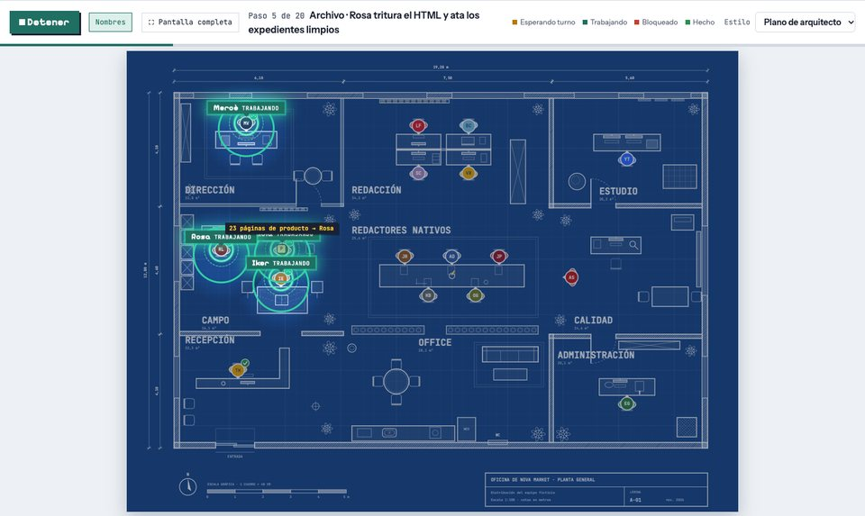 | 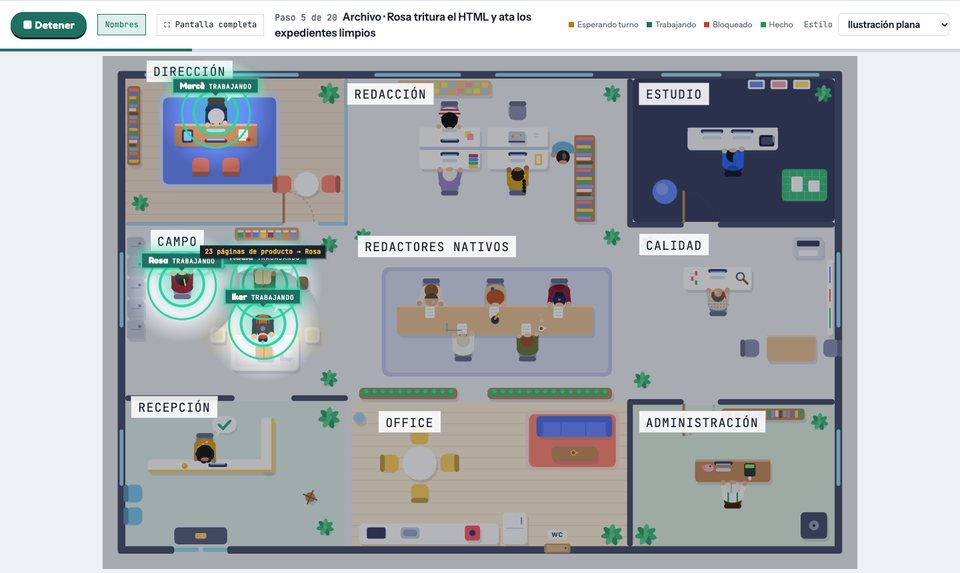 |
| **Maqueta de papel** | **Pizarra a mano** |
| 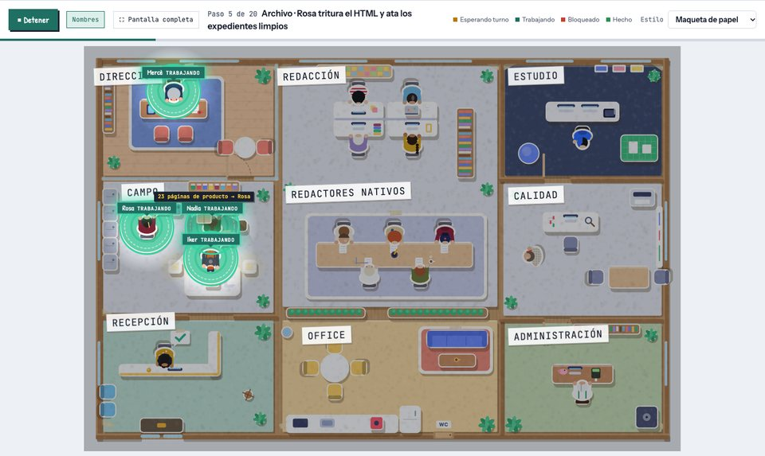 | 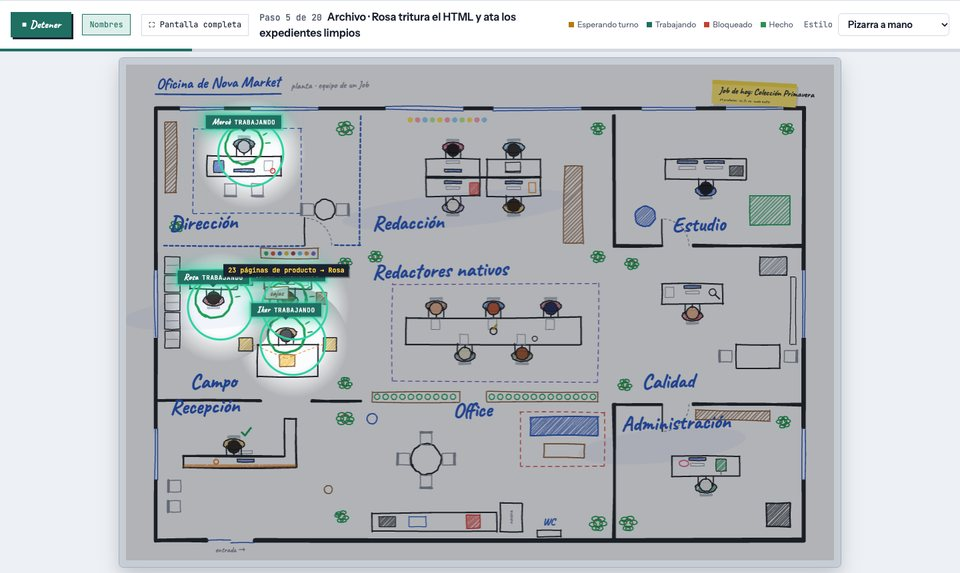 |
| **Holográfico** | **3D realista** |
| 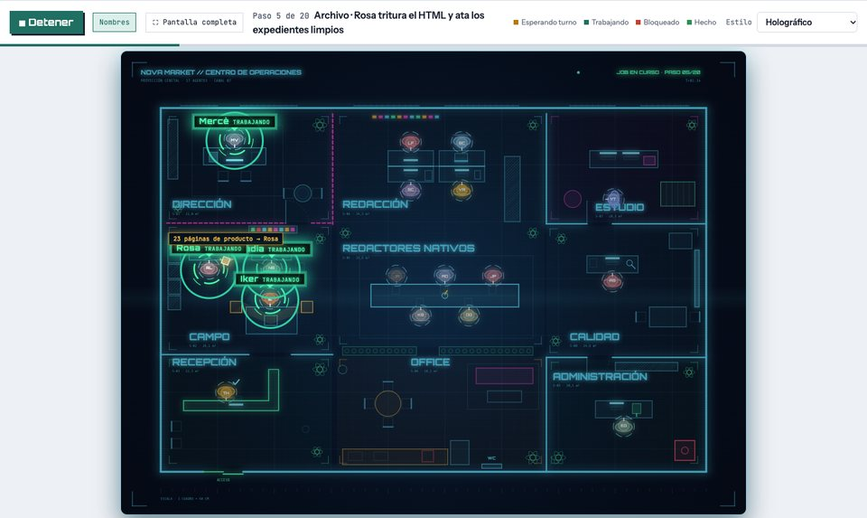 | 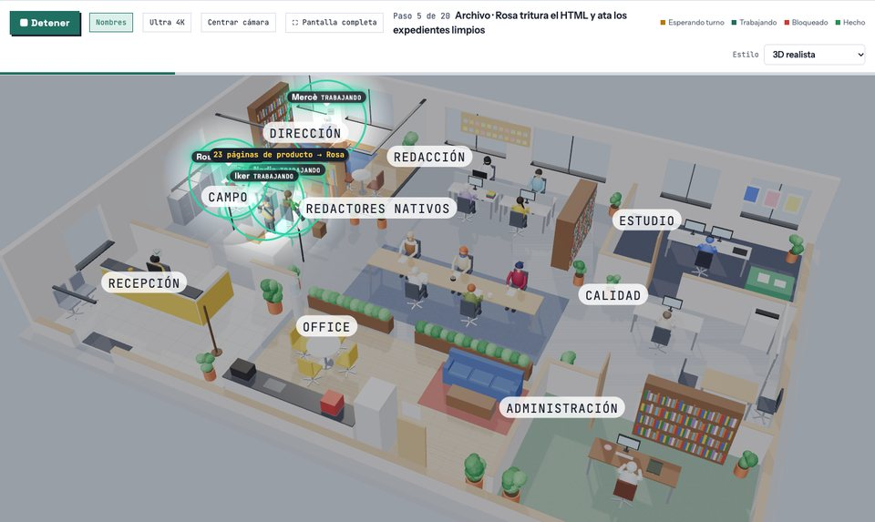 |

</details>

---

## 🌟 Una oficina que se siente viva

<table>
<tr>
<td width="50%" valign="top">

**🔦 Foco en quien trabaja**
El resto de la oficina se atenúa y quien está activo se ilumina con un anillo que late. Ves de un vistazo en qué punto está el trabajo.

**📦 El trabajo pasa de mano en mano**
Los objetos vuelan de una mesa a otra con su etiqueta: el pedido, los productos, las fotos, los textos…

**☕ Vida de oficina real**
Quien no tiene tarea teclea, se estira y, de vez en cuando, va a por un café, a la nevera o al baño. Si coinciden, charlan. Si el trabajo les necesita, vuelven corriendo a su mesa.

**🖱️ Pulsa a cualquiera**
Ves qué está haciendo ahora mismo, su labor y todo lo que ha hecho en este trabajo.

</td>
<td width="50%" valign="top">

**📣 El jefe anuncia el final**
Al terminar, la oficina se oscurece, un foco ilumina al jefe y presenta el informe con los resultados.

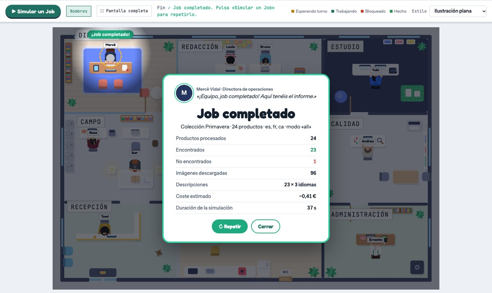

</td>
</tr>
</table>

---

## ⚡ En directo con tu aplicación

Lo más potente: **la oficina se puede conectar a tu aplicación** para que el equipo se mueva con los trabajos reales. Cuando tu app procesa un pedido, ves a cada persona hacer su parte; cuando termina, el jefe enseña los números de verdad.

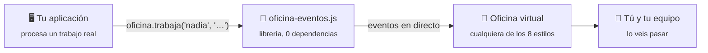

Conectarla son unas pocas líneas en tu código. **El plugin las escribe por ti** y te enseña los cambios antes de tocar nada:

```js
const oficina = require('./lib/oficina-eventos');
app.get('/oficina/eventos', oficina.sse);              // la ruta que escucha la oficina

const c = oficina.canal(pedido.id);                     // un canal por trabajo
c.inicio({ titulo: 'Pedido 123', resumen: '24 productos' });
c.trabaja('nadia', 'Busca el producto 4 de 24');        // Nadia se ilumina y se pone a trabajar
c.entrega('nadia', 'rosa', 'box', 'Producto 4');        // la caja vuela de su mesa a la de Rosa
c.progreso(0.25);
c.fin({ filas: [['Procesados', '24'], ['Encontrados', '22', 'ok'], ['No encontrados', '2', 'mal']] });
```

| Llamada | Qué ves en la oficina |
|---|---|
| `inicio` | La oficina pasa a modo directo |
| `trabaja` · `espera` · `bloqueado` · `hecho` · `libre` | El estado de cada persona, con su foco y su registro |
| `entrega` | Un objeto vuela de una mesa a otra |
| `paso` · `progreso` | El texto y la barra de progreso de arriba |
| `fin` | El jefe anuncia el final con el informe |

> 🔒 **Seguro por diseño:** avisar a la oficina nunca puede romper ni frenar el trabajo real. Quien abre la oficina a mitad de un trabajo ve en qué punto va. Funciona con el login de tu aplicación.

---

## 🚀 Empezar en 1 minuto

**1. Instala el plugin** en Claude Code:

```
/plugin marketplace add maomur/livestage
/plugin install livestage@livestage
```

**2. Escribe en tu proyecto:**

```
/livestage
```

**3. Responde tres preguntas** (qué analizar, qué quieres recibir y en qué estilo) y deja que trabaje.

> 👀 ¿Quieres verlo antes de instalar nada? Abre la **[demo en directo](https://maomur.github.io/livestage/demo/)**: es exactamente lo que tendrás en tu proyecto, con un trabajo de ejemplo.

---

## 🧭 Cómo funciona

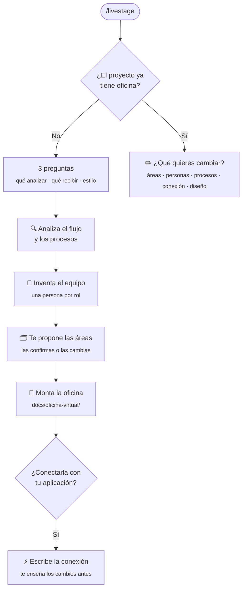

**¿Ya la tienes?** Vuelve a escribir `/livestage` y, en vez de analizar de nuevo, te pregunta qué quieres cambiar: el nombre de un área, quién se sienta dónde, el nombre de un proceso… Todo vive en un solo archivo, `docs/oficina-virtual/datos.js`, que también puedes editar a mano.

**¿Prefieres hablar normal?** También funciona: *«analiza cómo funciona esta app»*, *«qué equipo haría falta para esto»*, *«enséñame al equipo en una oficina»*.

---

## 📦 Qué recibes

| | Entregable | Descripción |
|:-:|---|---|
| 🏢 | **La oficina virtual** | 8 estilos, selector, simulación, vida de oficina e informe final. Se abre a pantalla completa |
| 👥 | **El equipo ficticio** | Una ficha por persona: nombre, edad, ciudad, estudios, experiencia, responsabilidades y frase característica |
| 📄 | **Informe para IT** *(opcional)* | Un HTML listo para adjuntar a una tarea de Jira: flujo, procesos, equipo, matriz de responsabilidades y tareas detectadas con criterios de aceptación |
| ⚡ | **Conexión en directo** *(opcional)* | La librería y las llamadas en tu código para que la oficina se mueva con los trabajos reales |

---

## 🗺️ Estructura del repositorio

```
.claude-plugin/marketplace.json            el catálogo de plugins
plugins/livestage/
├── .claude-plugin/plugin.json             datos y versión del plugin
├── commands/livestage.md                el comando /livestage (modo guiado)
└── skills/livestage/
    ├── SKILL.md                           las instrucciones que sigue Claude
    ├── assets/
    │   ├── oficinas/                      los 8 estilos + datos.js de ejemplo
    │   ├── conexion/oficina-eventos.js    la librería para conectar tu aplicación
    │   └── plantilla.html                 plantilla del informe para IT
    ├── references/
    │   ├── oficina-virtual.md             cómo se adapta la oficina a cada equipo
    │   └── conexion.md                    cómo se conecta a una aplicación
    └── scripts/oficina.py                 buscar · instalar · migrar · comprobar · librería
docs/demo/                                 la demo en directo (GitHub Pages)
docs/img/                                  las imágenes de este README
```

---

## ❓ Preguntas frecuentes

<details>
<summary><b>¿Las personas del equipo son reales?</b></summary>
<br>
No. Son perfiles inventados y siempre se marcan como ficticios. Lo único inventado son las personas: los procesos, el flujo y los datos salen del análisis de tu aplicación.
</details>

<details>
<summary><b>¿Qué pasa con mis claves y secretos?</b></summary>
<br>
Nunca entran en la oficina ni en el informe. De tu <code>.env</code> solo se leen los nombres de las variables, nunca sus valores.
</details>

<details>
<summary><b>¿Cuánta gente cabe en la oficina?</b></summary>
<br>
La planta tiene 9 salas y 18 puestos. Puedes renombrar las salas, mover a la gente y hacer que dos áreas compartan sala. Para equipos más grandes habría que redibujar la planta.
</details>

<details>
<summary><b>¿En qué lenguajes funciona la conexión en directo?</b></summary>
<br>
La librería está hecha para <b>Node.js</b> (14 o superior). Para otros lenguajes, el formato es JSON sencillo sobre Server-Sent Events y el plugin escribe el equivalente.
</details>

<details>
<summary><b>¿Puedo cambiar nombres después?</b></summary>
<br>
Sí. Escribe <code>/livestage</code> de nuevo y elige qué cambiar, o edita <code>docs/oficina-virtual/datos.js</code>: el archivo explica arriba qué se puede tocar. Los 8 estilos lo recogen a la vez.
</details>

<details>
<summary><b>¿Cómo actualizo a la última versión?</b></summary>
<br>

```
/plugin update livestage@livestage
```

Y para llevar el nuevo diseño a una oficina que ya tienes, ejecuta <code>/livestage</code> y elige «Actualizar el diseño»: tus datos se mantienen.
</details>

---

<div align="center">

**Hecho con [Claude Code](https://claude.com/claude-code)**

<sub>Si te gusta lo que ves, ⭐ el repositorio y cuéntanos qué oficina has montado.</sub>

</div>
